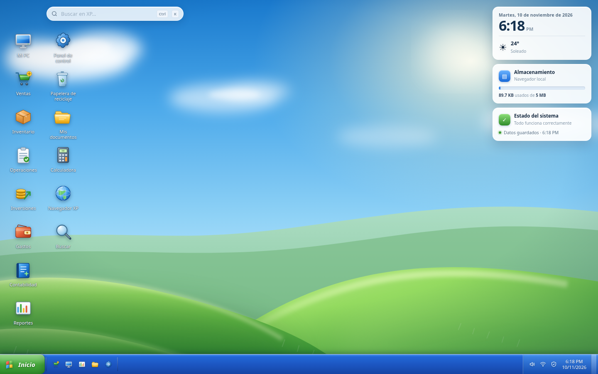
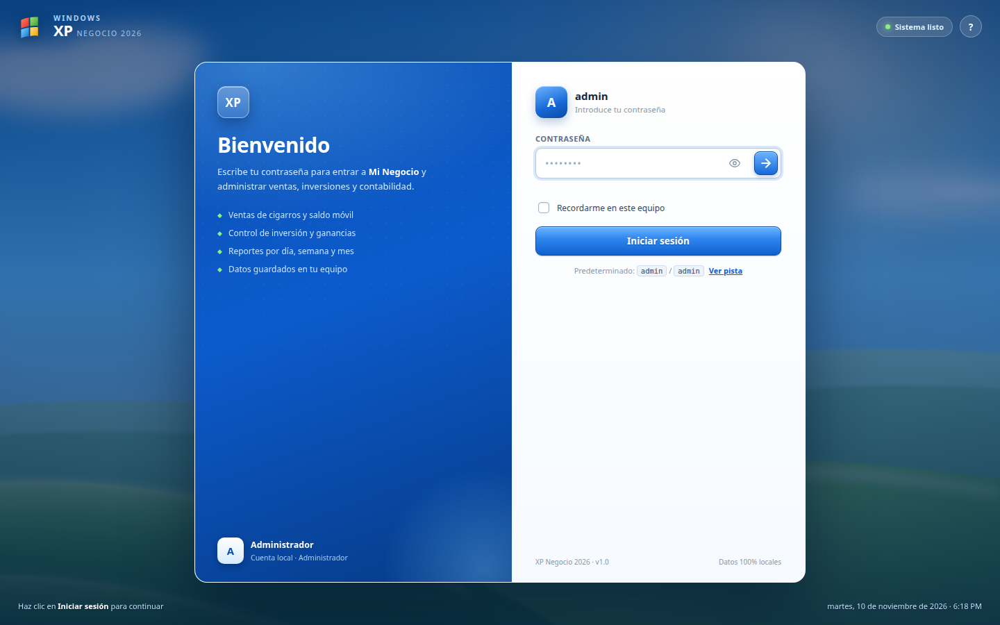
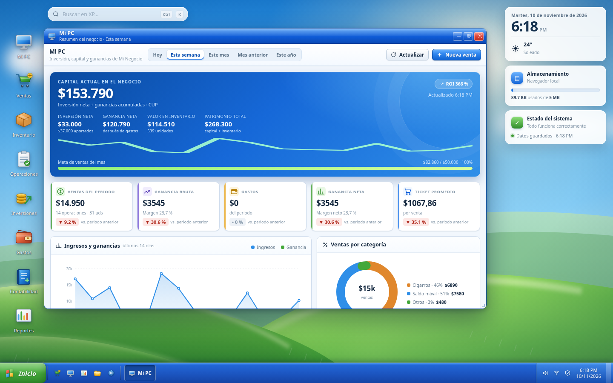
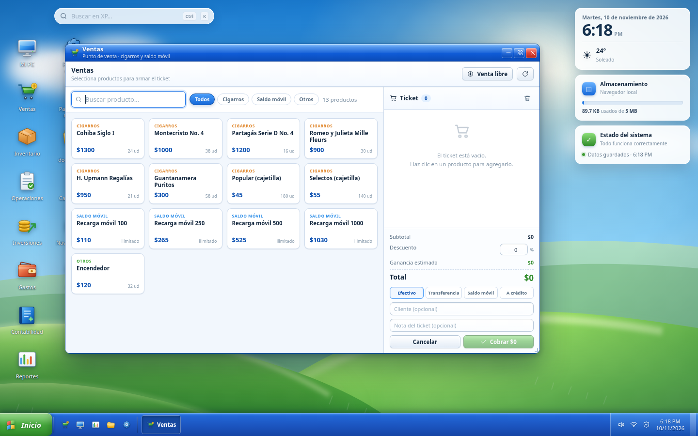
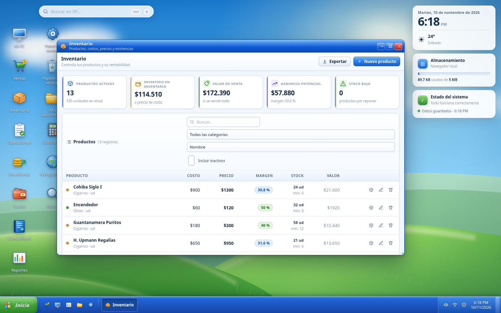
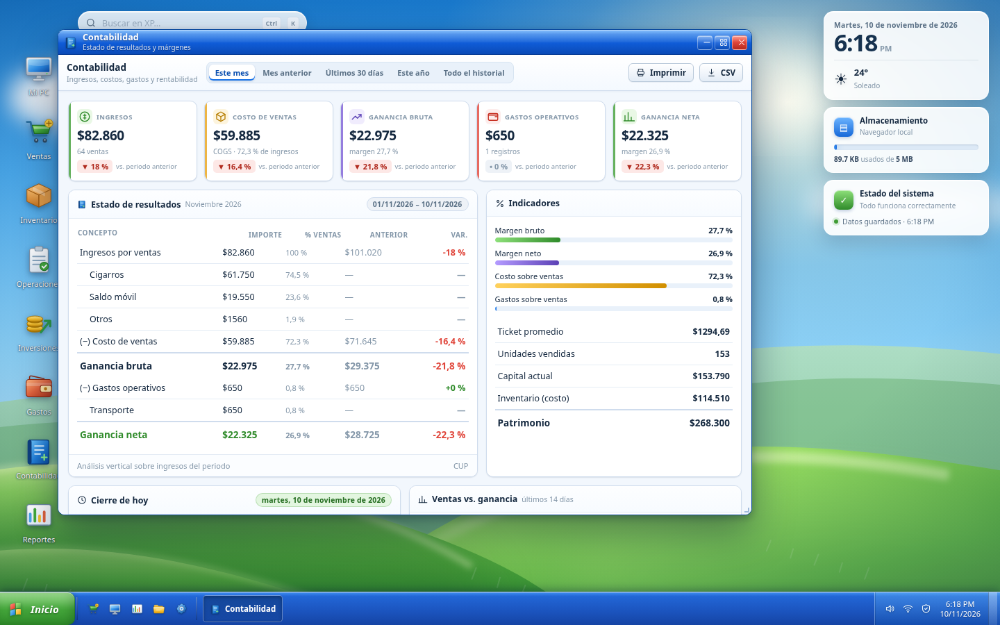
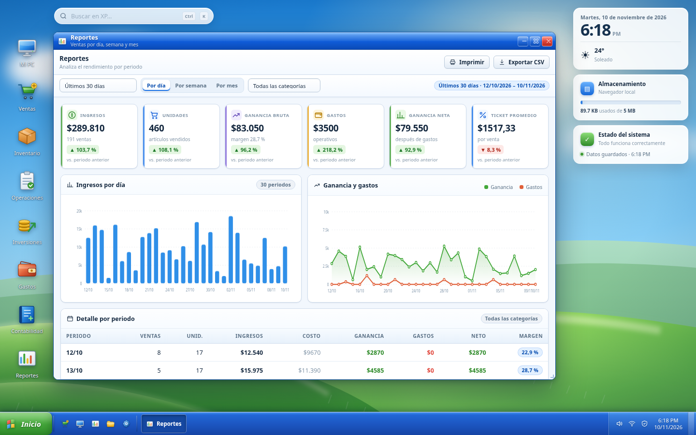
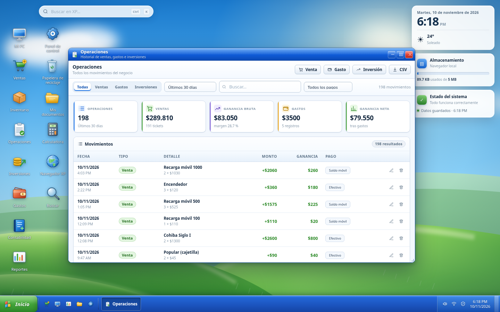
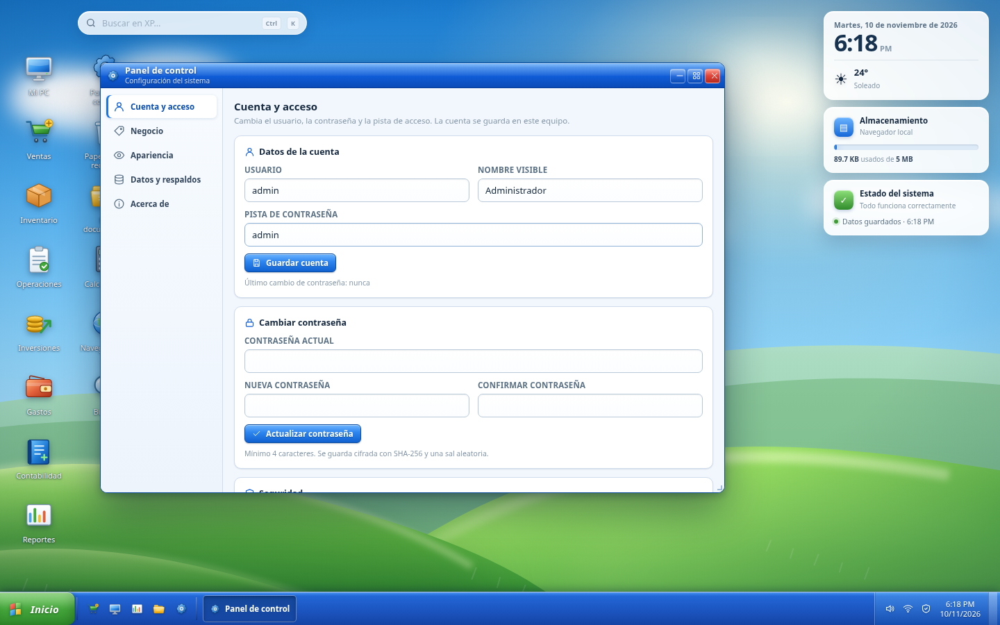

# XP Negocio 2026

> Escritorio web estilo **Windows XP** que funciona como sistema de gestión para un negocio de
> **venta de cigarros y saldo móvil**: ventas, inventario, inversiones, gastos, contabilidad y reportes.
>
> HTML + CSS + JavaScript puro (sin frameworks ni CDN) con backend **PHP opcional** para guardar en JSON.
>
> Versión **1.2.0**.



---

## Índice

- [Qué incluye](#qué-incluye)
- [Capturas](#capturas)
- [Cómo ejecutar](#cómo-executar)
- [Primer acceso](#primer-acceso)
- [Dónde se guardan los datos](#dónde-se-guardan-los-datos)
- [Respaldos](#respaldos)
- [Estructura del proyecto](#estructura-del-proyecto)
- [Atajos y gestos](#atajos-y-gestos)
- [Seguridad](#seguridad)
- [Desarrollo](#desarrollo)
- [Decisiones técnicas](#decisiones-técnicas)
- [Estado del proyecto](#estado-del-proyecto)
- [Licencia](#licencia)

---

## Qué incluye

### Escritorio

- Arranque y **pantalla de inicio de sesión XP** con usuario, contraseña, "recordarme" y pista.
- **Gestor de ventanas** real: arrastrar, redimensionar, minimizar, maximizar, foco, cascada y botones en la barra de tareas.
- **Memoria de ventanas**: cada app se abre en la posición y el tamaño donde la dejaste, y maximizada si así la cerraste.
- **Iconos arrastrables**: mueve cualquier icono con el ratón o el dedo; se ajusta a la cuadrícula y recuerda su sitio.
- **Escala de pantalla en %** (80–160 %) y **tamaño del texto en %** (80–150 %) desde Panel de control → Pantalla.
- **Menú Inicio** de dos columnas, accesos rápidos, bloqueo, cierre de sesión y apagado.
- **Widgets**: reloj con calendario, clima editable, almacenamiento real y estado del sistema (también visibles en móvil, en una fila compacta).
- **Buscador global** (`Ctrl` + `K`) que consulta productos, operaciones, notas y aplicaciones.
- Tres fondos (Bliss, Atardecer, Noche), animaciones y sonidos configurables.
- Diseño adaptable: en móvil y tablet las ventanas se maximizan y las apps se apilan en una columna.

### Apps de negocio

| App | Qué hace |
| --- | --- |
| **Mi PC** | Capital actual, inversión neta, ganancia, ROI, meta mensual, KPIs con comparación de periodo, gráficos, top productos, stock bajo y accesos rápidos. |
| **Ventas (POS)** | Catálogo por categorías, búsqueda, ticket con cantidades, descuento %, método de pago, cliente y nota. Valida stock, descuenta inventario y genera ticket imprimible. Incluye **venta libre** para productos fuera del catálogo. |
| **Inventario** | Alta, edición, borrado lógico, ajustes de stock con motivo, costo/precio/margen, stock mínimo, filtros, orden y exportación CSV. |
| **Operaciones** | Historial unificado de ventas, gastos e inversiones con filtros por tipo, fecha, pago y texto; edición y envío a la papelera. |
| **Inversiones** | Aportes y retiros de capital, capital actual, ROI, evolución y tabla de movimientos. |
| **Gastos** | Registro por categoría, edición, gráfico por categoría y exportación CSV. |
| **Contabilidad** | Estado de resultados con análisis vertical, comparación con el periodo anterior, indicadores, cierre del día y exportación CSV/impresión. |
| **Reportes** | Rangos (hoy → todo, personalizado), agrupación por día/semana/mes, filtro por categoría, gráficos, tabla detallada, top productos, métodos de pago y CSV/impresión. |
| **Panel de control** | Cuenta y contraseña, pista, datos del negocio, moneda, meta, apariencia, widgets, respaldos, importar/exportar JSON, modo de guardado, borrar demo y restablecer. |
| **Papelera** | Restaurar o vaciar operaciones, productos y notas eliminados. |
| **Mis documentos** | Bloc de notas con autoguardado, búsqueda y copia al portapapeles. |
| **Calculadora** | Operaciones con teclado físico y en pantalla. |
| **Buscar** | Búsqueda global con resultados agrupados y accesos directos. |
| **Reloj y calendario** | Calendario mensual con ventas por día, resumen del día y detalle de operaciones. |
| **Ayuda** | Centro de ayuda con guías de uso. |

---

## Capturas

| | |
| --- | --- |
|  |  |
| **Inicio de sesión** | **Mi PC · resumen del negocio** |
|  |  |
| **Punto de venta** | **Inventario** |
|  |  |
| **Estado de resultados** | **Reportes por periodo** |
|  |  |
| **Historial de operaciones** | **Panel de control** |

---

## Cómo ejecutar

### Opción A · Servidor PHP (recomendado)

Habilita el guardado en archivo JSON y las copias de seguridad en el servidor.

```bash
php -S localhost:8000 router.php
```

Abre <http://localhost:8000>.

### Opción B · Solo estático

La aplicación funciona sin PHP (los datos viven en el navegador):

```bash
python3 -m http.server 8000
# o simplemente abre index.html en el navegador
```

> En modo estático el Panel de control mostrará "Servidor no detectado" y el guardado en JSON quedará deshabilitado.

### Opción C · Vista previa de un solo archivo

Genera un `preview/index.html` autocontenido (CSS, JS e imágenes embebidos) para publicar en cualquier hosting estático:

```bash
node tools/build-preview.mjs
```

---

## Primer acceso

| Usuario | Contraseña |
| --- | --- |
| `admin` | `admin` |

La primera vez se cargan **45 días de datos de demostración** (productos, ventas, gastos e inversiones) para que veas el sistema con contenido realista.

Cámbialos en **Panel de control → Cuenta y acceso**. También puedes eliminarlos desde **Panel de control → Datos y respaldos → Borrar datos de demostración**.

---

## Dónde se guardan los datos

| Modo | Ubicación | Cuándo usarlo |
| --- | --- | --- |
| **Navegador** (por defecto) | `localStorage` del navegador | Uso personal en un solo equipo, sin servidor. |
| **Servidor PHP** | `data/app-data.json` | Quieres un archivo real, respaldos automáticos y poder abrirlo desde otro equipo de la red local. |

El modo se cambia en **Panel de control → Datos y respaldos → Modo de guardado**. Al activar el modo servidor se envía el estado actual al archivo JSON; al recargar, la app lo lee desde ahí.

> `localStorage` es por navegador y por equipo. Si limpias los datos del sitio, se pierde la información: exporta respaldos con regularidad.

### Modelo de datos

```jsonc
{
  "version": 1,
  "settings": { "businessName": "...", "currency": "CUP", "currencySymbol": "$", "monthlyGoal": 50000, "theme": "bliss", "storage": "local", "..." : "..." },
  "auth": { "username": "admin", "salt": "...", "hash": "sha256...", "hint": "...", "changedAt": null },
  "products":   [ { "id": "prd_...", "name": "...", "category": "cigarros|saldo|otros", "cost": 0, "price": 0, "stock": 0, "minStock": 0, "unit": "ud", "trackStock": true, "active": true } ],
  "operations": [ { "id": "op_...", "kind": "venta|gasto|inversion", "date": "2026-11-10T18:30", "..." : "..." } ],
  "notes":      [ { "id": "note_...", "title": "...", "body": "...", "createdAt": "...", "updatedAt": "..." } ],
  "meta": { "createdAt": "...", "lastSavedAt": "...", "revision": 1 }
}
```

- Las ventas guardan un **snapshot de costo** (`unitCost`, `cost`, `profit`): editar un producto después no altera la ganancia histórica.
- El borrado es **lógico** (`deletedAt`) y se gestiona desde la Papelera.

### Cómo se calcula

```
Ganancia bruta = Ingresos − Costo de ventas (COGS)
Ganancia neta  = Ganancia bruta − Gastos operativos
Capital actual = Aportes − Retiros + Ganancia neta acumulada
Patrimonio     = Capital actual + Inventario a costo
ROI            = Ganancia neta / Inversión neta
Margen         = Ganancia bruta / Ingresos
```

---

## Respaldos

- **Exportar JSON** descarga todo el estado (`Panel de control → Datos y respaldos`).
- **Importar JSON** reemplaza los datos actuales (pide confirmación y recarga la app).
- En modo servidor, cada guardado crea **una copia por hora como máximo** en `data/backups/` y conserva las últimas 20.
- Puedes crear una copia manual con **Crear copia en servidor**.

---

## Estructura del proyecto

```
xp-negocio-2026/
├── index.html                 # shell: arranque, login, escritorio, barra de tareas, menú Inicio
├── index.php                  # entrada para Apache/PHP (sirve index.html)
├── api.php                    # API JSON: ping / load / save / backup / backups
├── router.php                 # router para `php -S`, bloquea /data
├── .htaccess                  # cabeceras de seguridad, bloqueo de /data y caché
├── assets/
│   ├── css/                   # base, login, desktop, window, apps
│   ├── img/                   # fondos (bliss/sunset/night) y favicon
│   └── js/
│       ├── core/              # icons, store, charts, ui, wm
│       ├── apps/              # 16 apps registradas
│       └── desktop.js         # arranque, login, iconos, widgets, menú
├── data/                      # JSON y copias (no se versiona)
├── docs/screenshots/          # capturas para la documentación
├── preview/index.html         # bundle autocontenido generado
├── tools/build-preview.mjs    # generador de la vista previa
├── README.md
├── CHANGELOG.md
├── HANDOFF.md
└── LICENSE
```

---

## Atajos y gestos

| Acción | Atajo / gesto |
| --- | --- |
| Buscar en todo el sistema | `Ctrl` + `K` |
| Bloquear la sesión | `Ctrl` + `L` |
| Cerrar menús o diálogos | `Esc` |
| Abrir icono seleccionado | `Enter` |
| Abrir app | Doble clic en el icono |
| Maximizar / restaurar ventana | Doble clic en la barra de título |
| Menú contextual del escritorio | Clic derecho en una zona libre |
| Mostrar el escritorio | Botón del extremo derecho de la barra de tareas |

---

## Seguridad

Esta versión está pensada para **uso personal o de un equipo de confianza en red local**:

- La autenticación es **del lado del cliente** (`SHA-256` + sal aleatoria en el navegador). Protege el acceso casual, no es seguridad multiusuario real.
- `api.php` **no tiene autenticación propia**: no lo expongas a internet sin añadir autenticación y HTTPS.
- La carpeta `data/` está bloqueada vía `.htaccess` y `router.php`; los datos solo se leen a través de `api.php`.
- No se envía nada a servicios externos: sin CDN, sin analítica, sin fuentes remotas.

Recomendaciones:

1. Cambia la contraseña inicial en el primer arranque.
2. Activa el bloqueo automático si dejas el equipo desatendido.
3. Exporta un respaldo JSON con frecuencia.
4. Si publicas la app, hazlo detrás de una VPN o con autenticación adicional en el servidor.

---

## Desarrollo

```bash
# Servidor con PHP
php -S localhost:8000 router.php

# Solo estático
python3 -m http.server 8000

# Regenerar la vista previa de un solo archivo
node tools/build-preview.mjs
```

Notas de arquitectura:

- **Scripts clásicos** (no ES modules) para poder abrir `index.html` sin servidor.
- **Estado único** en `XP.store` con `save()` debounced y eventos `change` / `saved` / `import` / `reset`.
- Ventanas "en vivo" (`win.live = true`) que se re-renderizan cuando cambian los datos.
- Gráficos e iconos son **SVG propios**: funciona sin conexión.

---

## Estado del proyecto

- ✅ Núcleo, las 16 apps y el backend PHP funcionan y están probados de extremo a extremo.
- ✅ Diseño adaptable (escritorio, tablet y móvil) y accesibilidad básica (foco visible, etiquetas ARIA, navegación por teclado).
- ✅ Documentación, capturas, licencia y registro de cambios.
- 🔜 Ideas: exportación a PDF, multi-usuario con roles, sincronización opcional en la nube, lector de código de barras para el POS.

Consulta [CHANGELOG.md](CHANGELOG.md) para el detalle de correcciones y [HANDOFF.md](HANDOFF.md) para el estado de traspaso.

---

## Licencia

[MIT](LICENSE) © 2026 Manuel Almaguer

Hecho con HTML, CSS y JavaScript sin dependencias. La estética Windows XP pertenece a Microsoft;
este proyecto es una recreación con fines educativos y de uso personal.
